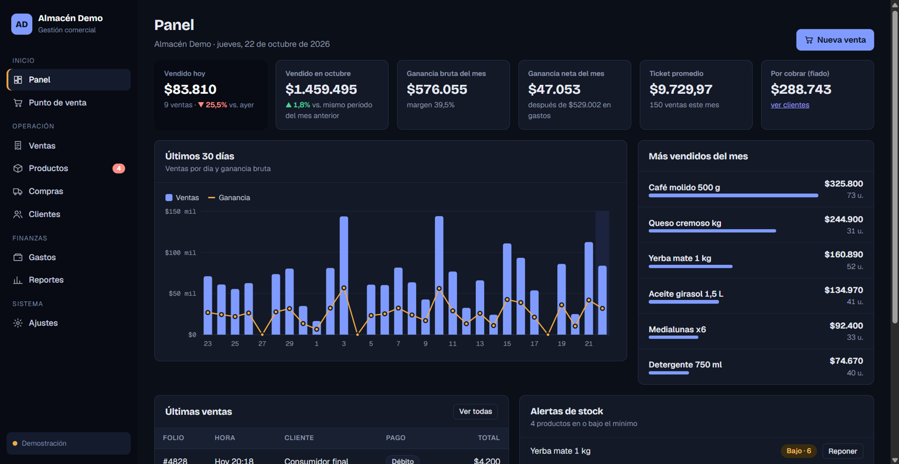
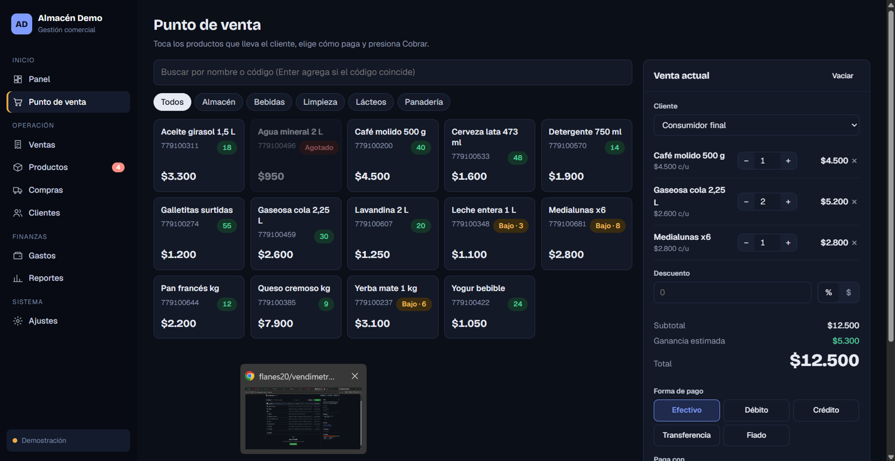
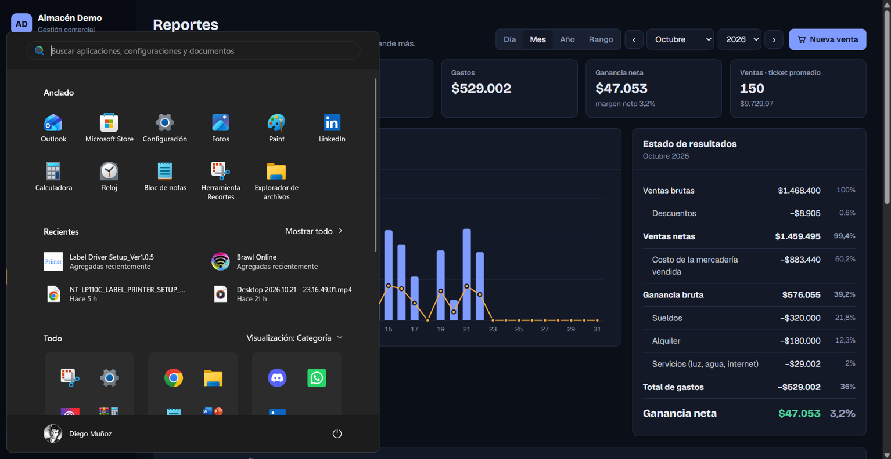

# Vendímetro

Programa de ventas e inventario para negocios pequeños, como almacenes, kioscos o ferreterías. Funciona en **Mac y Windows**, sin internet, y guarda todo en la computadora.



## Descargar

Las versiones listas para instalar están en **[Releases](../../releases/latest)**:

| Archivo | Para qué computadora |
|---|---|
| `Vendimetro-Mac-Apple-Silicon.dmg` | Mac de 2020 en adelante (chip M1, M2, M3, M4) |
| `Vendimetro-Mac-Intel.dmg` | Mac anteriores a 2020 |
| `Vendimetro-Windows.exe` | Windows 10 y 11 |

Instrucciones paso a paso: [Cómo usar en Mac](Cómo%20usar%20en%20Mac.txt) · [Cómo usar en Windows](Cómo%20usar%20en%20Windows.txt).

## Qué hace

- **Punto de venta:** buscador y lector de código de barras; efectivo con vuelto, débito, crédito, transferencia y cheque (queda por cobrar hasta registrar que se cobró); descuentos; tickets para imprimir.
- **Inventario:** costo, precio, margen y stock de cada producto; alertas de stock bajo; historial de entradas y salidas.
- **Compras y proveedores:** la mercadería comprada se suma sola al stock y actualiza el costo.
- **Clientes:** cuánto compra cada uno por mes y cuánto debe si se le fía.
- **Gastos:** alquiler, sueldos, servicios… para calcular la ganancia real.
- **Reportes:** ventas y ganancia por día, mes, año o rango de fechas; por producto, categoría, cliente y forma de pago; estado de resultados.
- **Excel:** exporta cualquier tabla o todo junto (.xlsx) e importa productos y clientes desde una planilla.
- **Datos seguros:** base de datos en la computadora, copia de seguridad diaria automática, y la venta en curso se guarda sola si el programa se cierra.

| Punto de venta | Reportes |
|---|---|
|  |  |

## Dónde se guardan los datos

En `Documentos/Vendímetro/ventas.db` (una base de datos SQLite), con copias diarias en `Documentos/Vendímetro/Respaldos`. Cada computadora tiene sus propios datos: no se sincronizan ni se envían a ningún lado.

## Para desarrollar

Requiere Python 3.11 o más nuevo.

```bash
pip install pywebview openpyxl
python app.py
```

- `app.py`: abre la ventana, sirve la interfaz y guarda los datos en SQLite.
- `web/index.html`: toda la interfaz (pantallas, estilos y lógica).
- `pruebas/`: pruebas que abren el programa real y verifican ventas, stock, Excel y guardado (`python pruebas/prueba_e2e.py`).

Cada cambio que se sube a GitHub ejecuta las pruebas y arma los instaladores de Mac y Windows (ver `.github/workflows/compilar.yml`). Los instaladores quedan en la pestaña **Actions**; para publicarlos se crea una versión nueva en **Releases**.

## Licencia

© 2026 flanes20. **Todos los derechos reservados.** El código está público solo para que se pueda ver como portafolio: no se permite copiarlo, modificarlo, venderlo ni usarlo en otros programas sin permiso escrito del autor. Ver [LICENSE](LICENSE).
